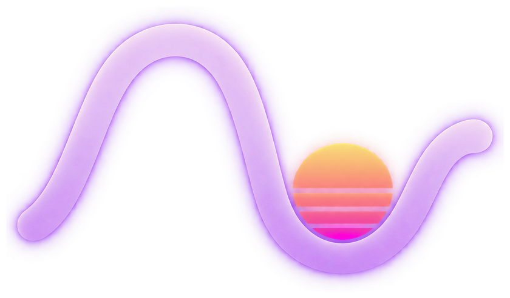

<p align="center">
  
</p>

<h1 align="center">Retrograd</h1>

<p align="center">
  Run and train GGUF models: an OpenAI-compatible server, and LoRA or
  full-weight training with SFT, preference optimization, PPO, GRPO, agentic
  GRPO, distillation and decision models.
</p>

<p align="center">
  <a href="https://github.com/tterrasson/retrograd/actions/workflows/ci.yml"></a>
  <a href="LICENSE"></a>
</p>

Retrograd runs and trains GGUF models directly. The model is loaded as is, with
no conversion step, on a `llama.cpp` fork. Training and serving share one
step-wise generation engine, so a rollout and an HTTP request go through the
same scheduler.

For training, `ggml` autograd works on the model in memory. By default
Retrograd trains a LoRA adapter, written as a standard GGUF that `llama.cpp`
loads with `--lora`. It can also train the model's own weights, all of them or
a selection. One TOML file describes the whole run.

- **Serving**: an OpenAI-compatible API (Chat Completions, Responses,
  Completions, Embeddings) with token streaming, batched requests, a shared
  prefix cache and structured outputs. Several LoRA adapters of one base can
  share a decode. Native decision models answer typed questions on
  [`POST /v1/systemone`](https://tterrasson.github.io/retrograd/running/api#decisions).
- **Algorithms**: SFT (plain text, chat or tool conversations), offline
  preference optimization (DPO, IPO, SimPO, ORPO), PPO, GRPO (token- or
  sequence-level importance sampling, as in GSPO), distillation from a teacher
  model, supervised decision training, and multi-turn agentic GRPO with MCP
  tools and sandboxed environments.
- **Data from rollouts**: `retrograd collect` turns the successful traces of
  an agentic configuration into SFT records, or into preference pairs with
  `--pairs`, from the local model or an OpenAI-compatible endpoint.
- **What is trained**: a LoRA adapter (default), all base weights, a selection
  of them, or an adapter plus norms and biases.
- **Optimizers**: AdamW (default), SGD, Muon and Gefen.
- **Devices**: CPU everywhere, GPU through Metal (macOS), Vulkan or CUDA.
- **Models**: F16 or quantized base models (Q4_0 to Q8_0, K-quants, i-quants,
  MXFP4) for LoRA training. The lowest-bit formats are not supported on Metal;
  see the [support matrix](https://tterrasson.github.io/retrograd/engineering/SUPPORT).
- **Interfaces**: a CLI, a standalone inference server (`retrograd-infer`), a
  server for training runs with a web interface (`retrograd-server`), the
  `retrograd` Rust crate and Python bindings.

## Build

The `llama.cpp` fork is a git submodule:

```sh
git clone --recurse-submodules https://github.com/tterrasson/retrograd.git
cd retrograd
cargo build --release
```

For an existing clone without the submodule, run `scripts/setup-llama-cpp.sh`
first.

GPU backends are chosen with Cargo features. The CPU is always included:

```sh
cargo build --release                     # Metal on macOS, CPU elsewhere
cargo build --release --features vulkan   # needs the Vulkan SDK
cargo build --release --features cuda     # needs the CUDA Toolkit
cargo build --release --features mcp,container   # MCP tools and container sandboxes for agentic GRPO
```

The servers are separate binaries. Build them together with the root package,
which is what enables the GPU backend for them:

```sh
cargo build --release -p retrograd -p retrograd-server -p retrograd-serve
```

Requirements per backend are in
[Build variants](https://tterrasson.github.io/retrograd/reference/builds).

## Quick start

A rank-1 adapter trained for one epoch on a few lines of text checks that
everything works:

```sh
cargo run --release -q -- train examples/smoke_tiny_sft.toml --model MODEL.gguf
```

Without a model at hand, fetch the small test model once and drop `--model`:

```sh
scripts/fetch-cpu-fixture.sh
cargo run --release -q -- train examples/smoke_tiny_sft.toml
```

The example runs on the CPU; add `--device gpu` to use the GPU. A successful
run ends with a finite `train_loss` and writes the adapter to
`/tmp/retrograd-smoke-adapter.gguf`.

`examples/smoke_tiny_ppo.toml`, `examples/smoke_tiny_grpo.toml` and
`examples/smoke_tiny_gspo.toml` (GRPO with sequence-level ratios) do the same
for the reinforcement learning algorithms, on eight arithmetic questions
scored by `examples/smoke_rl_reward.py`. Use
`examples/smoke_tiny_preference.toml` for DPO on a few preference pairs. The
[register machine](examples/register_machine/README.md) is a complete GRPO
example with an exact reward and held-out evaluation.

The [decision smoke test](https://tterrasson.github.io/retrograd/training/decision#smoke-test)
shows how to answer typed questions and train a tiny decision model on CPU.

The [quickstart](https://tterrasson.github.io/retrograd/getting-started/quickstart)
walks through a first real run.

## Running a model

`retrograd-infer` serves a GGUF and its adapters, with no training code in the
binary. A TOML file describes what to serve:

```toml
# serve.toml
model = "/models/base.gguf"
n_ctx = 8192

[[adapters]]
name = "tuned"
path = "/models/tuned.gguf"
```

```sh
./target/release/retrograd-infer serve.toml
```

The base model is served under the id `base`, and each adapter under its name:

```sh
curl http://127.0.0.1:8000/v1/chat/completions \
  -H 'content-type: application/json' \
  -d '{"model": "tuned", "messages": [{"role": "user", "content": "Hello"}]}'
```

`retrograd serve run.toml` does the same from a training configuration, and
`retrograd-server` serves the runs it trains, including a run still in
progress. See
[Running models](https://tterrasson.github.io/retrograd/running/).

## Usage

```sh
retrograd inspect --model base.gguf              # architecture and LoRA targets
retrograd preflight --model base.gguf --strict   # operations the device cannot run
retrograd train run.toml                         # train; --resume continues a stopped run
retrograd bench run.toml --adapter adapter.gguf  # base model against adapter, same examples
retrograd chat run.toml --compare                # base model and adapter, turn by turn
retrograd decide --model base.gguf --request request.json  # answer typed questions
retrograd serve run.toml                         # OpenAI-compatible API on 127.0.0.1:8000
retrograd-infer serve.toml                       # the same, for a model and its adapters
retrograd-server server.toml                     # runs and serving over HTTP, on 127.0.0.1:8471
```

Agentic runs add `tools list`, `scenarios generate`, `judge eval` and
`collect`, and offline distillation adds `distill-teacher`. See the
[CLI reference](https://tterrasson.github.io/retrograd/reference/cli) and the
[configuration reference](https://tterrasson.github.io/retrograd/reference/configuration).

## Documentation

The documentation is at <https://tterrasson.github.io/retrograd/>. Its source is
a VitePress site in [`docs/`](docs/) (`cd docs && bun install && bun run docs:dev`).

- **Running**: [running models](https://tterrasson.github.io/retrograd/running/),
  [OpenAI-compatible API](https://tterrasson.github.io/retrograd/running/api),
  [Retrograd server](https://tterrasson.github.io/retrograd/running/server).
- **Training**: [SFT](https://tterrasson.github.io/retrograd/training/sft),
  [preference optimization](https://tterrasson.github.io/retrograd/training/preference),
  [decision models](https://tterrasson.github.io/retrograd/training/decision),
  [PPO](https://tterrasson.github.io/retrograd/training/ppo),
  [GRPO](https://tterrasson.github.io/retrograd/training/grpo)
  (and its [GSPO option](https://tterrasson.github.io/retrograd/training/grpo#sequence-level-importance-sampling-gspo)),
  [agentic GRPO](https://tterrasson.github.io/retrograd/training/agent),
  [tools and toolsets](https://tterrasson.github.io/retrograd/training/tools),
  [distillation](https://tterrasson.github.io/retrograd/training/distill),
  [observing rollouts](https://tterrasson.github.io/retrograd/training/observe).
- **Data**: [dataset formats](https://tterrasson.github.io/retrograd/getting-started/datasets),
  including tool conversations and preference pairs.
- **Operations**: [checkpoints and metrics](https://tterrasson.github.io/retrograd/operations/checkpoints),
  [performance and memory](https://tterrasson.github.io/retrograd/operations/performance),
  [web interface](https://tterrasson.github.io/retrograd/operations/web-ui).
- **Engineering**: [contribution rules, test lanes, backends and RIR kernels](https://tterrasson.github.io/retrograd/engineering/).

## Libraries

The Python bindings are a separate `uv` project in [python/](python/); see
[python/README.md](python/README.md). The CLI does not need Python.

The Rust API is the `retrograd` crate:

```rust
use retrograd::{LoraConfig, Result, TrainConfig, Trainer};

fn main() -> Result<()> {
    let mut trainer = Trainer::new("base.gguf", TrainConfig::default())?;
    trainer.create_lora(&LoraConfig::qv(8, 16.0))?;
    let tokens = trainer.tokenize_text("training text goes here")?;
    let metrics = trainer.train_tokens(&tokens)?;
    trainer.save_lora("adapter.gguf")?;
    println!("loss={}", metrics.train_loss);
    Ok(())
}
```

## Tests

Use the lane scripts rather than a raw `cargo test` or `pytest`. They pick the
backends, fixtures and build directories a change needs:

```sh
scripts/test-fast-rust.sh     # every change
scripts/test-fast-python.sh   # changes to Python or the configuration
```

[Tests and validation](https://tterrasson.github.io/retrograd/engineering/tests/notice)
lists which lane to run for which change.

## Contributing

Start with [the contribution principles](https://tterrasson.github.io/retrograd/engineering/contributing).
The `llama.cpp` fork lives in `crates/retrograd-ffi/runtime/vendor/llama.cpp`;
[the fork workflow](https://tterrasson.github.io/retrograd/engineering/LLAMA_CPP_FORK_WORKFLOW)
explains how to sync and publish it.

## License

Retrograd is licensed under the [MIT License](LICENSE). It includes, as a git
submodule, a fork of `llama.cpp` (which bundles `ggml`), also MIT-licensed. See
[NOTICE](NOTICE) for third-party attribution and
[the fork's provenance and changes](crates/retrograd-ffi/runtime/third_party_notes/LLAMA_CPP_SOURCE.md).
